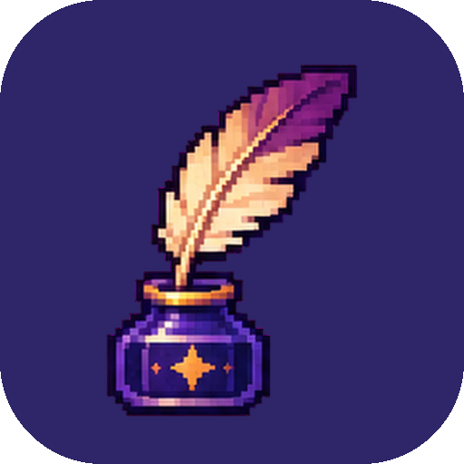

<h1 align="center">Inkling</h1>

Study in an academy of magic, with creatures that learn alongside you. 
<a href="https://github.com/bigdevwhale/inkling/releases/latest/download/Inkling.apk">Download APK</a> · <a href="README.ru.md">Русский</a>

You are a student of an old academy of magic, and your room is at the top of a tower. Every real subject belongs to one of its schools: calculus to Numerology, programming to Artificing, languages to Runes, anatomy to Healing. While you study, the creatures in your tower feed on knowledge, and at night they grow – as memory does in sleep. It works at school, at college, at university and for studying on your own.

## What's inside

- **Any subject.** Name it as you call it – «Strength of materials», «Civil law», «Year 9 maths» – and it finds its school of magic among fourteen. Change it if you like.
- **The candle.** A timed lesson: choose what you're working on, light it and put the phone face down – the circle closes. Picking the phone up makes the flame flicker; that's counted, not punished. A break follows, and the cat likes real breaks.
- **The timetable.** Bells, odd and even weeks, terms and holidays. After each class: were you there, what was set (with a photo of the board, due at the next class of that subject), what stuck. In the evening the hob helps pack tomorrow's satchel. Quiet during lessons.
- **Tasks and trials.** Homework, labs that are done, handed in and defended, essays, projects, coursework and a thesis in stages that warm a dragon's egg. Exams, credits, tests, state exams: tickets pasted as a list, the sphinx drawing a ticket, readiness by level, practice papers and a predicted score.
- **Marks.** Any scale – 1–5 with weights, 10 and 12 points, a points system, A–F, pass/fail. The term mark as it stands and «two more 5s for a 5». The record book, GPA weighted by credits, and whether the grant is safe.
- **The grimoire.** What you learned becomes a spell; the sphinx asks it after 1, 3, 7, 21 and 60 days.
- **Teach the familiar.** Explain a topic in your own words, typed or aloud, while the echo raven asks why, for an example and to put it simpler. Where words fail is what to learn next.
- **The mimic's chest** keeps questions until you find the answers.
- **24 creatures**, found by the way you study – the salamander for an undisturbed hour, the gargoyle for classes attended, the sphinx for recalls. Six stats each and a speciality from the school it was raised on; three live in the tower and double mana for their thing.
- **Your wand**, made of your study: wood from your main school, core from your leader, length from hours, carvings from finished materials.
- **The chronicle.** Hours by week and month, a calendar, the star of schools, hours against credits, the memory curve, attendance and deadlines, hours of the day and session lengths, a year in the academy. Eleven kinds of share cards.
- **No punishment.** Weeks count, not days; holidays and the infirmary lose nothing.

## Install

Download [Inkling.apk](https://github.com/bigdevwhale/inkling/releases/latest/download/Inkling.apk) on a phone with Android 9 or later, open it and allow installs from that source when Android asks.

## Privacy

No ads, no account, no analytics. Everything stays on the phone; only the town's coordinates go online, for the weather in the window. See [PRIVACY.md](PRIVACY.md).

## Building

Android Studio or `./gradlew assembleDebug`. `-Pdemo` builds `app.inkling.demo` with four months of a student's life for screenshots; `./gradlew testDebugUnitTest -Prender --tests '*RenderScreens*'` draws every screen and card to `app/build/art`. The pixel art was generated with `tools/gen_art.py` and cut with `tools/cut.py`.

## License

MIT
