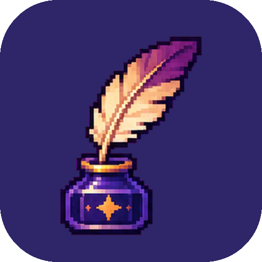
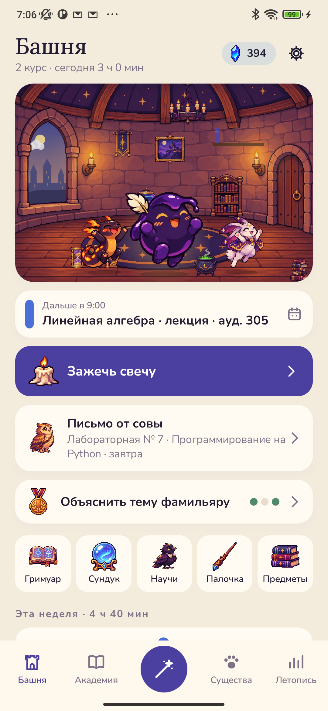
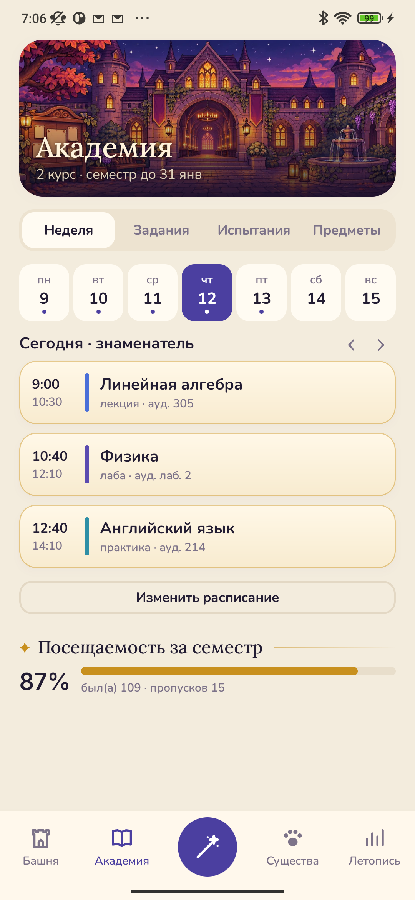
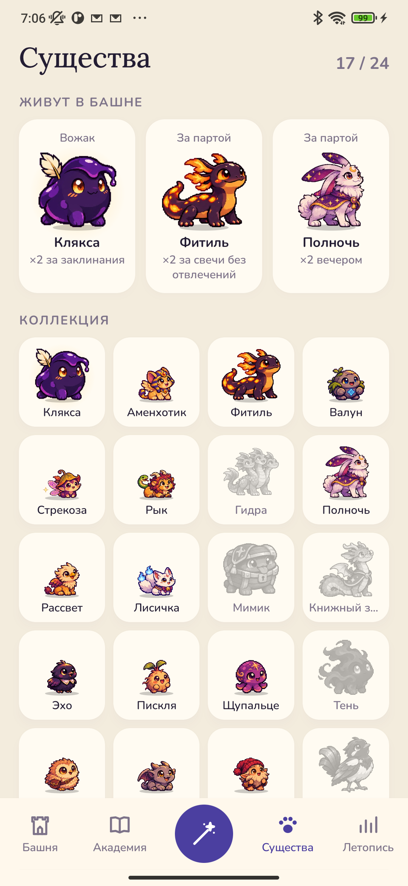
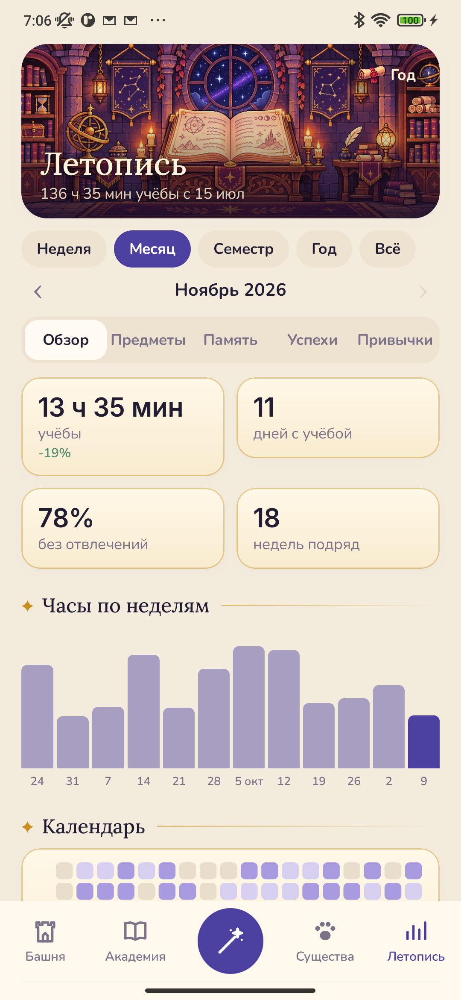

<h1 align="center">Inkling</h1>

Учёба в академии магии вместе с волшебными существами. 
<a href="https://bigdevwhale.github.io/stillcraft/apps/inkling/">Сайт</a> · <a href="https://github.com/bigdevwhale/inkling/releases/latest/download/Inkling.apk">Скачать APK</a> · <a href="README.md">English</a>

Вы поступили в старую академию магии и живёте в комнате на вершине башни. Каждый ваш предмет относится к одной из школ магии: матанализ – к Нумерологии, программирование – к Артефакторике, языки – к Рунам, анатомия – к Целительству. Пока вы занимаетесь, существа в башне набираются знаний, а ночью растут. Приложение подходит для школы, колледжа, вуза и для самостоятельной учёбы.

## Что внутри

- **Любые предметы.** Напишите название так, как оно звучит у вас: «Сопромат», «Гражданское право», «Алгебра». Приложение само подберёт одну из четырнадцати школ магии, а если ошибётся – её легко сменить.
- **Свеча.** Это урок с таймером. Выберите, чем займётесь, зажгите свечу и положите телефон экраном вниз. Если взять телефон в руки, пламя дрогнет: это отмечается, но ничем не грозит. После свечи – перемена.
- **Расписание.** Звонки, числитель и знаменатель, четверти, семестры и каникулы. После пары приложение спросит, были ли вы на ней и что задали. Задание можно сфотографировать с доски, и срок сам встанет на следующее занятие. Школьнику вечером поможет собрать портфель домовой. Во время уроков приложение молчит.
- **Задания и испытания.** Домашние задания, лабораторные (сделана, сдана, защищена), рефераты, проекты, курсовая и диплом по этапам. Экзамены, зачёты, контрольные, ОГЭ и ЕГЭ. Билеты можно вставить списком, сфинкс вытянет любой из них, а по пробным вариантам приложение предскажет балл.
- **Оценки.** Любая шкала: пятибалльная с весами, десяти- и двенадцатибалльная, баллы БРС, буквы A–F, зачёт. Видно, что выходит за четверть и сколько пятёрок не хватает до пятёрки. Есть зачётка, средний балл с учётом кредитов и подсказка про стипендию.
- **Гримуар.** То, что вы запомнили на занятии, становится заклинанием. Сфинкс спросит его через день, три дня, неделю, три недели и два месяца.
- **Научи фамильяра.** Объясните тему своими словами – текстом или голосом. Ворон будет переспрашивать: почему так, приведите пример, скажите проще. Где не нашлось слов, там и стоит доучить.
- **Сундук мимика** хранит вопросы, пока вы не найдёте ответы.
- **24 существа.** Каждое появляется за свою привычку: саламандра – за час без отвлечений, гаргулья – за посещённые пары, сфинкс – за то, что вы вспоминаете выученное. У существ шесть характеристик и специальность по школе, на которой их растили. Трое живут в башне и приносят вдвое больше маны за своё дело.
- **Своя палочка.** Она складывается из вашей учёбы: дерево – от главной школы, сердцевина – от вожака, длина растёт с часами, а за каждый законченный курс появляется резьба.
- **Летопись.** Часы по неделям и месяцам, календарь, звезда школ, часы против кредитов, память, посещаемость и сроки, лучшее время для учёбы и итоги года. Одиннадцать открыток, чтобы поделиться.
- **Без наказаний.** Важна неделя, а не каждый день. На каникулах и в лазарете ничего не пропадает.

## Установка

Скачайте [Inkling.apk](https://github.com/bigdevwhale/inkling/releases/latest/download/Inkling.apk) на телефон с Android 9 или новее, откройте файл и разрешите установку из этого источника.

## Приватность

Без рекламы, аккаунта и аналитики. Всё хранится на телефоне; в интернет уходят только координаты города, чтобы показать погоду за окном. Подробнее – в [PRIVACY.md](PRIVACY.md).

## Лицензия

MIT
